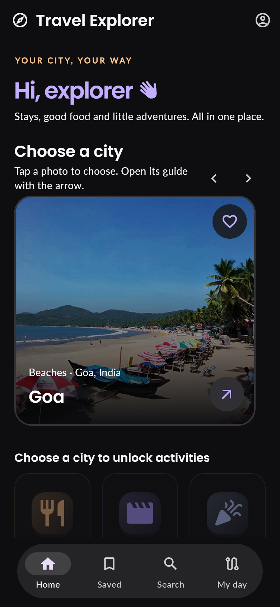
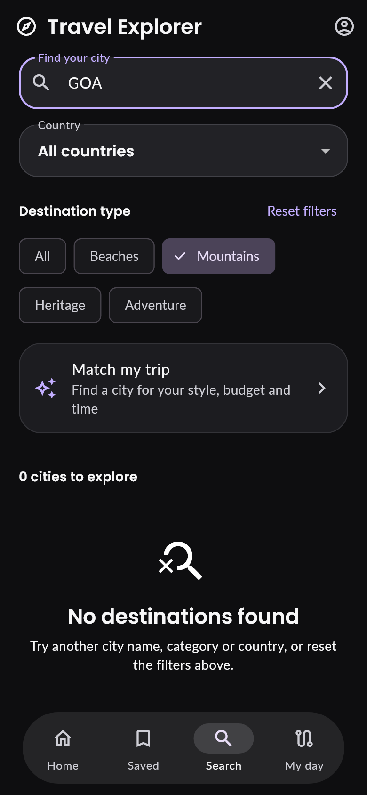
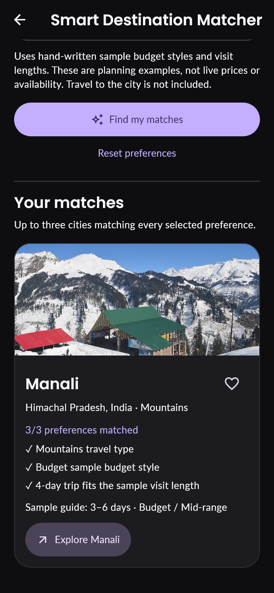
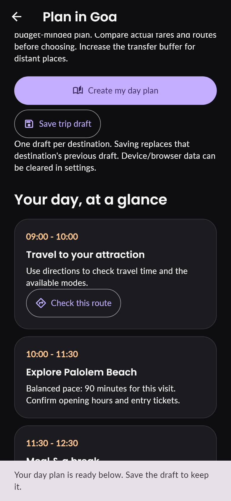

# Travel Explorer

A beginner-friendly Flutter app for the GDGC VNRVJIET App Development assignment.
Discover cities, save favourite destinations, and create editable travel plans.

## Assignment features

- **Discovery:** ten destinations in India, France and Italy across Beaches,
  Mountains, Heritage and Adventure. Cards show a photo, name, location and category.
- **Navigation and details:** Home, city guides and a separate Saved wishlist.
  Every city has a description, visiting season and two or three photographed attractions.
- **Search and filtering:** case-insensitive name search combined with category
  and country. Clear the name or reset all filters; no-result messages explain what to change.
- **Wishlist:** add/remove hearts update the shared state on all screens.
  Saved IDs persist on the same device, browser profile and origin.

## Additional features

- **Smart Destination Matcher:** choose travel type, budget style and 1–7 days.
  One point per matching preference, with reasons and clearly labelled partial matches.
  Budget styles and visit lengths are hand-written examples, not live price quotes.
- Citywide stays, dining, shopping, events and activity categories. A read-only
  Neon directory contains 24 curated entries, with a bundled JSON fallback.
- External Maps links for places, hotels and transit/cab/walking/bicycle directions.
- My day holds up to five outings, one stay and one meal, with a city-specific picker.
- Day planning uses an optional starting location, editable visits/breaks and transfer
  buffers. It rejects schedules past midnight and supports saving/copying drafts.
- Whole-trip mode plans 2–7 days in one city, with independently editable days.
- Dark Material 3 UI, bundled Poppins/Lato fonts, photo fallbacks, onboarding and preferences.
- Optional web Google/email sign-in. Personal trips remain device-local.

## Run locally

Checked with **Flutter 3.47.7 / Dart 3.13.5**. Install the
[Flutter SDK](https://docs.flutter.dev/install/manual), Git and Chrome or Edge.
Open this project folder in VS Code, then run:

```sh
flutter pub get
flutter run -d web-server --web-hostname 127.0.0.1 --web-port 8767
```

Open `http://127.0.0.1:8767/` in your normal browser. Reuse the same address and
browser profile to retain saved places. Clearing site data removes them.
The Codex preview at port 8766 has separate saved data.

On the development laptop the bundled SDK can also be used through:

```powershell
./run-app.ps1 -Device web-server -Port 8767
```

For Android, install Android Studio and its SDK, accept the SDK licences, connect
a device or emulator, then use `flutter run`. Android source is included, but an
Android build/device test requires an SDK that is absent on the current laptop.

## Checks

```sh
dart format --output=none --set-exit-if-changed lib test tool
flutter analyze
flutter test --coverage
dart tool/check_core.dart
python tool/check_import.py
flutter build web --no-pub
```

The manual Pages deployment workflow runs formatting, analysis, tests and data checks
before building. Publishing requires the repository/Pages settings and Neon trusted
origin described in [HOSTING.md](docs/HOSTING.md).
Actual results and remaining submission actions are recorded in
[the final check](docs/FINAL_SUBMISSION_CHECK.md).

## How the code works

- `lib/models/destination.dart`: the fields for a city and its attractions.
- `lib/data/destinations.dart`: bundled destination objects.
- `lib/state/travel_controller.dart`: name/category/country filters, saved IDs and day drafts.
- `lib/screens/explorer_screen.dart`: Home, Search and Saved, listening for controller changes.
- `lib/models/destination_match.dart`: a pure Dart scoring function; sample profiles live in `lib/data/`.
- `lib/models/day_plan.dart`: minute arithmetic; screens use the day-only mode with no arrival formalities.
- `lib/services/local_store.dart`: local persistence adapters; whole trips use a separate storage key.
- `lib/services/place_catalog.dart`: the public directory and bundled fallback, separate from personal state.

The controller calls `notifyListeners()` after a change. Widgets then rebuild from
the same data. Search uses three AND conditions; filtering never deletes saved IDs.
Read [the beginner explanation](docs/EXPLAIN_TO_INTERVIEWER.md),
[search/matcher walkthrough](docs/SEARCH_AND_MATCHER.md), and
[planning modes](docs/PLANNING_MODES.md).

## Screenshots and demo

Captured from the actual Flutter UI at a 390 × 844 mobile layout in an isolated demo session:






A **2:50 demo** and a separate timed voice-over script are prepared in the workspace
`outputs/demo/` folder. Add your own narration, upload the final copy to Google Drive,
and add the real publicly viewable video link here before submitting.
See [the demo guide](docs/DEMO.md) and [submission steps](docs/SUBMISSION.md).

## Data, limitations and development approach

The core destination catalogue works without an account or backend. The original
six cities have bundled photos; the four added cities use remote photos with fallbacks.
See [image credits](docs/IMAGE_CREDITS.md) and [data sources](docs/DATA_SOURCES.md).
Some fields were checked against a Hugging Face dataset; a Kaggle import helper is
included, but an actual Kaggle dataset has not been bundled or claimed as imported.

There are no live bookings, fares, verified opening hours, cloud sync of personal
trips, intercity route optimisation or live weather. Weather is an optional PDF
enhancement and has not been implemented. Travel durations are user-chosen buffers;
use Maps for real route information. The directory uses HTTPS with a short-lived
guest token; no administrator/database password is embedded in the app.

Built with AI assistance. The code keeps data, state and screens separate so the
candidate can explain and modify the implementation. Web behaviour and automated
checks are documented; native Android and physical-phone testing remain separate.
