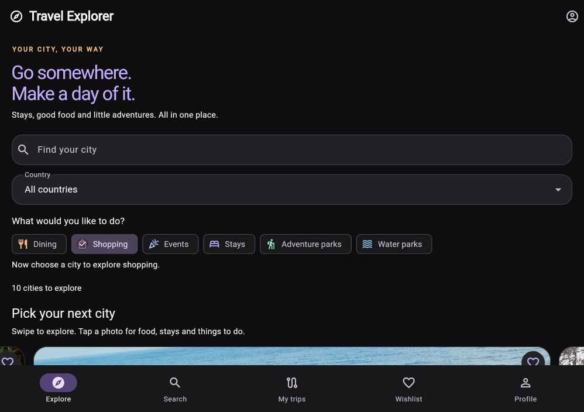
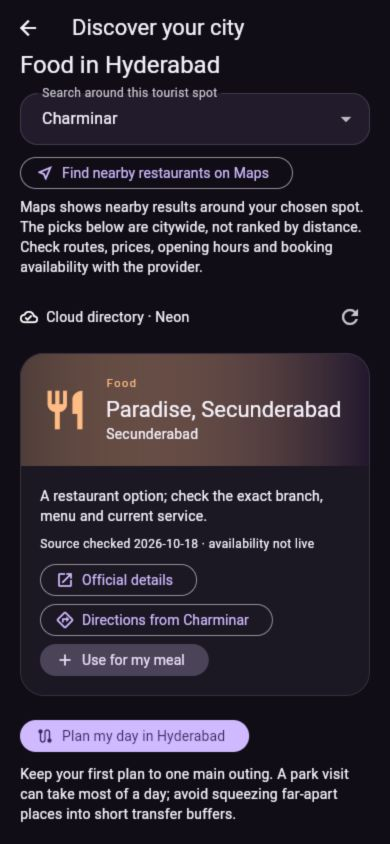
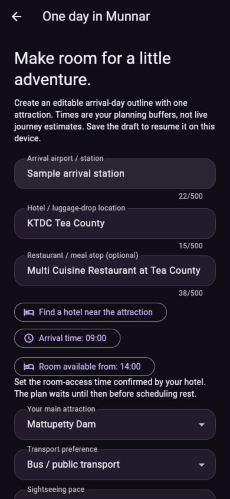

# Travel Explorer

A small Flutter app for the GDGC VNRVJIET App Development volunteer recruitment assignment. Explore destinations in India and abroad, save places, discover stays, food and outings, and make an editable day plan for any city.

## Features

- Ten destinations in India, France and Italy across Beaches, Mountains, Heritage, and Adventure.
- Swipeable city cards with photos, names, locations and wishlist buttons.
- Details with a description, best visiting season, and 2-3 named attractions with images.
- Case-insensitive city search and country filtering, plus activity choices for Dining, Shopping, Events, Stays, Adventure parks and Water parks.
- Clickable destination/attraction names open background and surroundings links.
- Nearby hotel searches, public transport/cab/walk/bicycle directions, Uber access, and bicycle-rental searches.
- An editable one-day timetable: arrival, hotel arrangements, rest, one attraction, meal, and return; copy the outline to keep it.
- A separate Wishlist screen with immediate add/remove updates.
- Video-inspired discovery UI: near-black backgrounds, charcoal surfaces, colourful category tiles, large city photos and source-linked place cards.
- Stays, Food, Adventure, Water parks and Shopping for every city, with a public Neon directory and citywide Maps searches.
- Use a directory stay, restaurant or outing in the planner; customise the visit duration and save the draft.
- Responsive layout, empty states, and image-loading/error placeholders.

## Run locally

Install the stable [Flutter SDK](https://docs.flutter.dev/install/manual), add its `bin` folder to PATH, and reopen your terminal. Git is required. Chrome or Edge provides a quick first run without Android emulator setup.

On this computer, `./run-app.ps1` can use the Flutter SDK already downloaded in the workspace. It launches Chrome. On another computer, install Flutter first, then use the commands below.

From this project folder:

```sh
flutter --version
flutter doctor
flutter pub get
flutter run -d chrome
```

For Android, install Android Studio and its SDK, accept licenses with `flutter doctor --android-licenses`, start an emulator or connect a USB debugging enabled device, and use `flutter run`. `flutter devices` lists available targets.

If platform folders have not yet been generated, run `flutter create --platforms=android,web --project-name travel_explorer .` first. This uses the standard Flutter project template; keep this app's `lib/`, tests, and README.

## Check the project

```sh
dart format lib test
flutter analyze
flutter test
flutter build web
dart tool/check_core.dart
```

See [verification notes](docs/VERIFICATION.md) for what has actually been checked. A passing build does not replace a real-device walkthrough.

## How it works

`lib/models/destination.dart` describes a destination and an attraction. `lib/data/destinations.dart` is the bundled sample list. `lib/state/travel_controller.dart` holds search text, the selected country/category, and saved destination IDs. `lib/screens/explorer_screen.dart` displays the current state and opens details using Flutter navigation. `lib/models/day_plan.dart` builds the timetable; `lib/screens/day_planner_screen.dart` collects and displays the inputs and stops.

When you tap a heart, the controller toggles an ID and calls `notifyListeners()`. Listening widgets rebuild from the same controller, so Home, Details, and Wishlist agree. Search and country conditions must both match. Activity choices decide which category opens after selecting a city. Filtering never removes a saved ID.

Start with [Learn the app in five small steps](docs/EXPLAIN_TO_INTERVIEWER.md). Read [data](docs/DATA.md), [state](docs/STATE.md), and [UI](docs/UI.md) for more detail. [Agent tasks](docs/AGENT_TASKS.md) documents how work was divided and how to request a small follow-up safely.

## Scope and limitations

The public place directory is connected to Neon on its Free plan, with a bundled fallback. No user login, private API key or embedded maps SDK is required to use the app. See [database and hosting](docs/HOSTING.md). Wishlist IDs and one trip draft per destination are saved locally: browser localStorage on web and SharedPreferences on Android. Reopening in the same browser profile and origin restores them. Clearing site/app data removes them; there is no account sync. Android storage still needs a device test.

Destination content combines curated samples with a few checked Hugging Face fields. See [data provenance and Kaggle status](docs/DATA_SOURCES.md). The original six destinations have offline photos; the four added cities load remote Commons photos. See [image credits](docs/IMAGE_CREDITS.md).

The cloud directory has 24 curated listings across all ten cities; each city has a sourced stay and dining example, while Maps searches supplement less populated categories. Hotel and transport buttons open external searches; there are no live prices, ranked hotel recommendations, reservations, or guaranteed cheapest fares. Availability varies by location. The day planner adds user-chosen time buffers and waits for the room-access time entered by the traveller; it does not optimise routes or fetch hotel/attraction opening times. It rejects plans that extend past midnight. Unsaved edits are lost when you leave; saved inputs restore from My trips or Wishlist.

External links work through a small web helper and an Android platform bridge. Android still needs a device test; unsupported platforms offer a copyable URL. No extra package download is required.

## Screenshots and demo

Captured from the running Flutter web app at a phone-sized viewport:





Demo video: record and add the publicly viewable Google Drive link before submission.

Follow the [2-3 minute demo checklist](docs/DEMO.md). The recruitment deadline is **22 October 2026, 11:59 PM IST**. Submit the public GitHub repository and publicly viewable Google Drive demo through the assignment form.

## Development approach

Built with AI assistance in Codex using separate tasks for UI, data, search/wishlist logic, and tests/documentation, with a coordinating integration pass. The candidate should be able to explain every submitted feature and describe the remaining limitations honestly.


## Saved trips, pace and city discovery

- Save favourite places and one editable trip draft per destination. Resume drafts from Wishlist.
- Choose Relaxed, Balanced or Packed pace; visit lengths are 120, 90 or 60 minutes. Rest remains editable.
- Choose any city on Explore, then Stays, Food, Adventure, Water parks, Shopping or Day plan. The earlier fixed Hyderabad demo is no longer the main flow.
- Learn the flow in `docs/EXPLAIN_TO_INTERVIEWER.md`; the discovery flow and next improvements are in `docs/DISCOVERY.md`.

For repeatable browser saving during development, run `./run-app.ps1 -Device web-server` in the VS Code terminal, then open `http://127.0.0.1:8767/` in your normal browser. Reuse the same address and browser profile. Flutter's automatically launched Chrome debug profile may be temporary; saving there is not a substitute for testing your regular browser. The existing Codex preview uses port 8766, a separate origin with separate saved data.

## Hosting

The database is connected; public web hosting is a separate step. A manual GitHub Pages deployment workflow is prepared. Read [HOSTING.md](docs/HOSTING.md) for repository setup, the Neon trusted-origin setting and verification. No public deployment has been made yet. This repository is private; pushing its source does not publish the app.

## City-first update — 19 October 2026
The app now opens a city category pop-up from each city photo, with citywide venue search, an Events discovery link and a profile screen. The palette uses near-black and charcoal with purple accents. See [the flow and login guide](docs/CITY_FIRST_AND_LOGIN.md) for implementation, testing and limitations. Web Google/email authentication is connected to Neon; completed account login still needs a user verification. Saved trips remain device-local.
